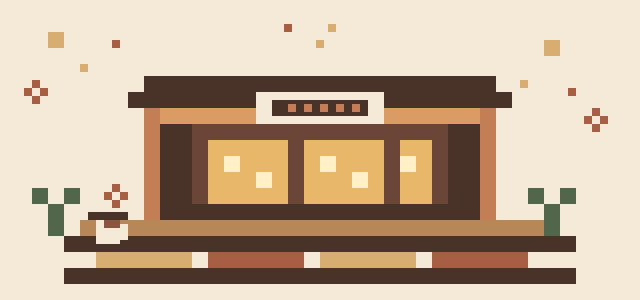
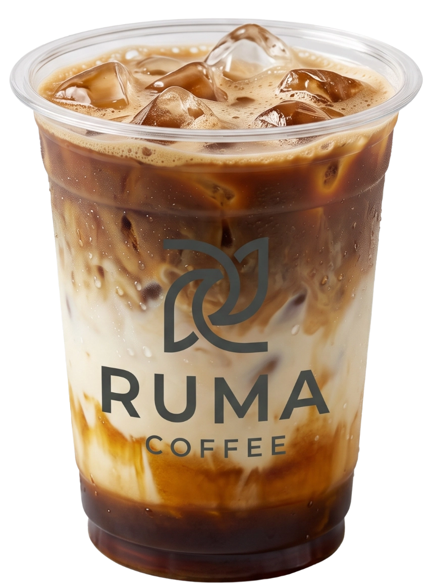
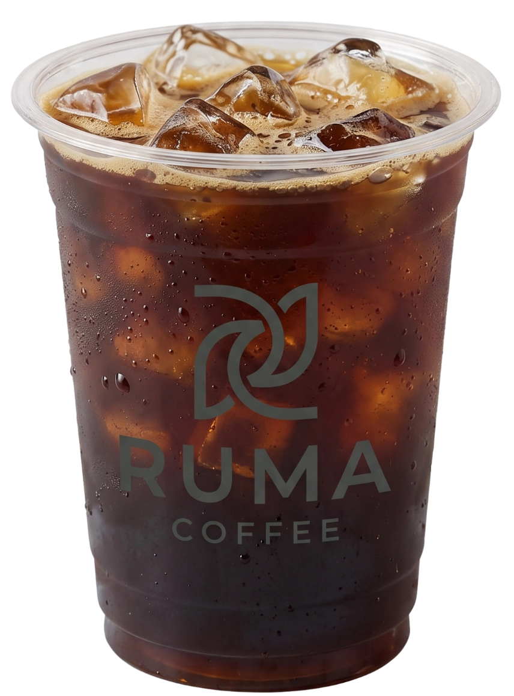
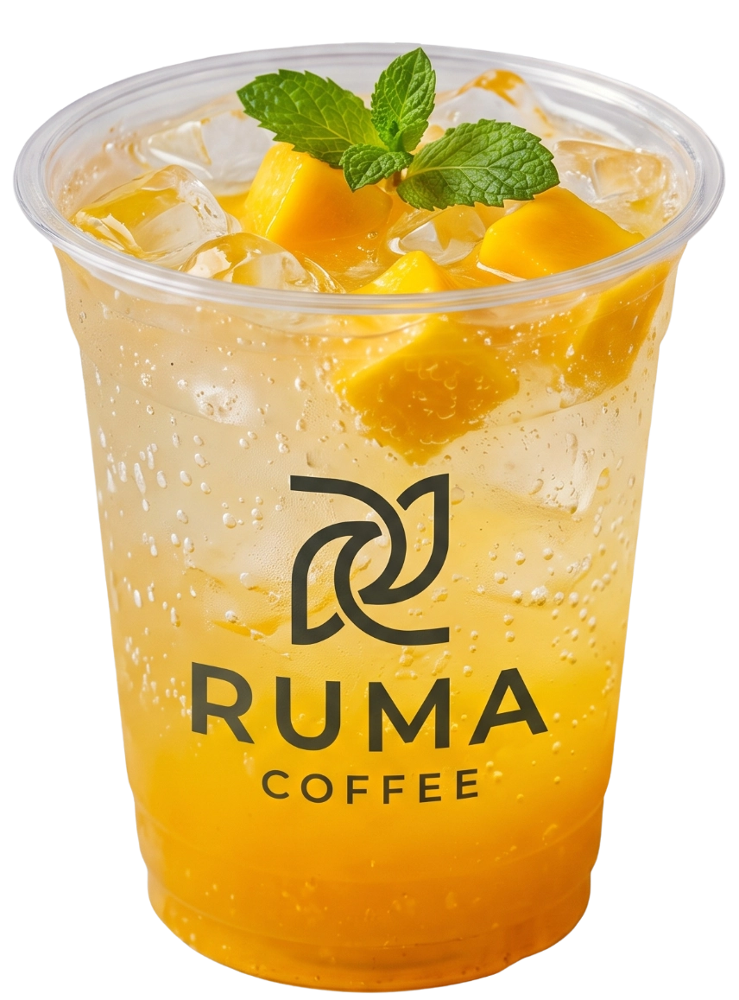

<div align="center">
  
  <h1>Ruma Coffee</h1>
  <p><em>More than coffee, a place to come home to.</em></p>
  <p>A warm, illustrated café website with a browsable menu and a front-end ordering demo.</p>
  <p>
    
    
    
  </p>
</div>

---

## About Ruma Coffee

Ruma Coffee is a café concept built around taking a pause, sharing a table, and feeling at home. This repository contains its public-facing website and a simulated menu-and-order experience.

## Experience the website

- Explore the café story, coffee craft, food and drink categories, and visitor moments.
- Browse the menu by category, search for an item, and customize drinks before adding them to a cart.
- Walk through a demo checkout, preview a receipt, and advance a simulated order status.
- Open the admin demo at `/projects/ruma-coffee/admin-demo` to explore sample products, orders, and reports. Its data is fictional and saved in the current browser only.

The ordering flow and admin dashboard are front-end demonstrations. They do not connect to a café point-of-sale system, payment service, or shared database.

## A taste of Ruma

These real menu images come with the project. They are not screenshots of the website.

<div align="center">
  
  
  
</div>

## Built with

- **React 19** and **React DOM** for the interface.
- **Vite 7** for local development and production builds.
- **Tailwind CSS 4** through the Vite plugin, alongside the project's own CSS stylesheets.
- **Framer Motion** and **GSAP** for interface animation.
- **Lucide React** for icons.

## Getting started

You will need Node.js and npm installed.

From the project root, install the dependencies and start Vite:

```bash
npm install
npm run dev
```

Vite prints the local address in the terminal after the development server starts.

To create and preview a production build:

```bash
npm run build
npm run preview
```

## Project map

```text
src/                 React app, landing page, menu, and admin demo
Home/                Source photography, category cards, and section artwork
public/assets/       Images, logos, video, and other files served by Vite
docs/assets/         README illustration
```

## Design philosophy

The site pairs Ruma's café photography and coffee-toned palette with small moments of motion and a menu that can be explored at your own pace. The pixel café in this README is an original nod to the feeling behind the brand: a little digital place to come home to.

---

<div align="center">
  <sub>Take a deep breath. You're home. ☕</sub>
</div>
